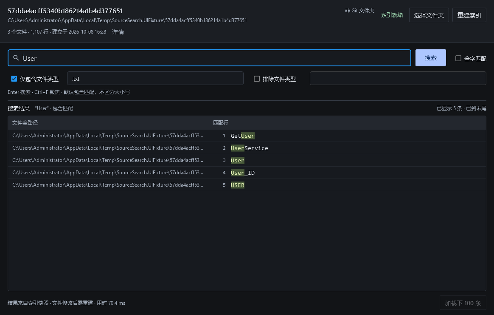
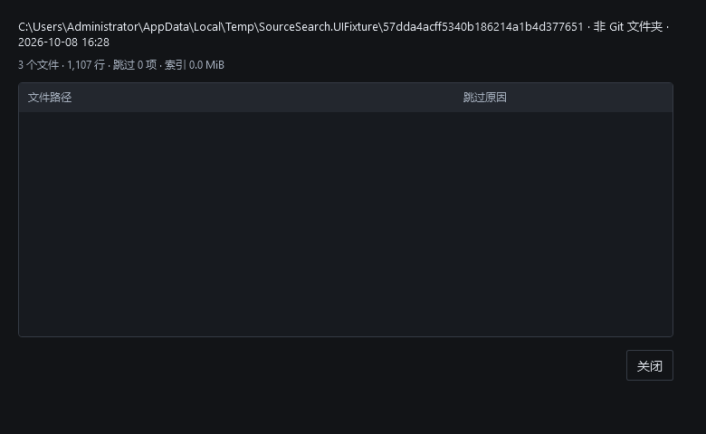

# 产品化第三阶段验证（2026-10-08）

基线 `f549a5a`，分支 `codex/materialdesign-ui`。实现用户批准的深色紧凑 MaterialDesign 界面，沿用 WPF/Presentation/Core 分层和 Lucene 搜索语义。

## 交付内容

- 三层界面：目录/分支/索引状态、搜索及两组后缀条件、路径与匹配行表格。窄窗口自动将过滤条件分行；Enter 搜索、Ctrl+F 聚焦、右键复制完整路径。
- 显示原始命中高亮、行号、已提交查询、条数/续页、空态和错误。编辑条件保留旧结果及其提交身份，并禁用续页。每批100行、界面1000行上限和虚拟化保持。
- 切换目录清空旧快照与结果；只读识别 Git 分支、游离 HEAD、普通目录或识别失败。激活窗口、建立前后读取身份，检测分支/HEAD 变化后禁止继续使用旧快照搜索。
- 索引详情显示来源、建立统计和跳过原因。没有引入持久分支缓存、增量重建、缓存管理器、输入即搜、正则或模糊搜索。

主题固定 MaterialDesignThemes 5.3.2，采用 MaterialDesign2 默认控件并设置紧凑尺寸；正式程序与验证宿主加载同一主题。选择 MD2 的代价是不采用 MD3 默认比例。查询过程不读取 Git、不扫描源目录。

## 功能验证

| 检查 | 结果 |
|---|---|
| Release 全解决方案构建 | 0 警告、0 错误 |
| Core 测试 | 93/93 |
| Presentation/架构测试 | 21/21 |
| 可见 WPF 冒烟 | 25/25 |
| 干净目录发布 Desktop | 成功，产物中无 Validation 文件 |
| 880×600 最小窗口 | 过滤条件分行，主要操作及结果区可见 |
| 应用内125%/150%布局缩放 | 主要操作与结果区可见；不等同物理DPI验证 |

新测试先观察 RED 再实现，覆盖快照清空等待在途reader、Git身份与取消、目录切换、延迟元数据去重/失效、建立前后HEAD变化、失败建立不能恢复过期快照、显式快照真实来源、已提交查询与编辑条件分离、UTF-16代理对与命中裁剪。

独立只读审核发现1项 Important、无 Critical/Minor：结果发布时未同步通知空态遮罩与查询标题，导致呈现检查点可能早于完整结果状态。已加入绑定通知回归测试，观察失败后修复为在渲染检查点之前发布相应状态；114项测试全部通过。最终小范围修复由作者测试和暂存区审核复核，未重复派审。

WPF冒烟直接验证真实窗口的主题资源、控件绑定、共用命令、可见高亮、详情、虚拟化和最小化测量拒绝。它不是物理鼠标/键盘输入测试。计算机控制辅助进程无法启动，原生目录选择、真实按键/鼠标及物理显示DPI仍待人工验证。

## 性能证据

前后复用同一批已有真实语料快照和查询集，不重建源仓库。C# 与混合语料各36组，每组5次预热、30次首批100行测量。计时包含查询、绑定、布局和下一次WPF rendering检查点，不等同物理显示器呈现。

完整前后原始样本、首次查询与环境信息保存在本目录 `stage3/before/`、`stage3/after/`；逐组比较见 `stage3/comparison.md`。这些文件不包含源码正文。

| 语料 | 改造前超100ms组数 | 改造后超100ms组数 | 改造前最慢P95 | 改造后最慢P95 | 峰值工作集前/后 |
|---|---:|---:|---:|---:|---:|
| C# | 29/36 | 31/36 | 388.81ms | 782.46ms | 542.7/610.5MiB |
| 混合 | 33/36 | 33/36 | 236.80ms | 604.34ms | 803.1/946.7MiB |

两套后测均有效、均未达到性能门槛，进程按预期返回1。首次查询从170.82/158.00ms上升至242.17/363.75ms。这次实测出现明显性能退化，不能宣称换肤没有性能代价；桌面顺序测量不能单独定位各控件的因果开销。建议在推进缓存前优先剖析结果绑定、Material控件布局及命中Run呈现成本，再用相同语料验证优化。此提交是UI功能阶段快照，不是性能验收通过或发布就绪版本。

首轮改造后C#测量因窗口不可见/最小化检查失败而无效，保留 `stage3/after/csharp-invalid-window.json`，不计入性能统计。在上述通知修复后重新测量有效数据；没有通过重复运行挑选达标样本。

末轮冒烟曾误用默认真实目录而未传夹具目录，已通过正常关闭窗口取消；源目录只读。随后使用标准夹具脚本完成25项冒烟，性能测量复用既有快照，与编译及其他基准串行执行。

## 取舍与交付边界

复用现有checkout中的专用分支及PowerShell流程记录，避免重试本会话已失败的隔离/脚本辅助工具；代价是没有第二份checkout和自动流程记录。现有用户执行与本地提交授权持续有效。

当前仍需手动建立索引，未验证独立安装位置和升级安装。工作区身份识别失败时显示“分支未识别”，不据此推断一致；文件内容修改不会自动触发重建。缓存及增量属于第4阶段，UI响应长尾和发布交付属于后续性能/发行阶段。没有新增延期Minor。

本地日志：`.tmp/stage3/tests-final.log`、`build-final.log`；原始可见冒烟：`artifacts/reports/ui-smoke.json`。截图均来自小型合成夹具；不是用户真实源码截图。

