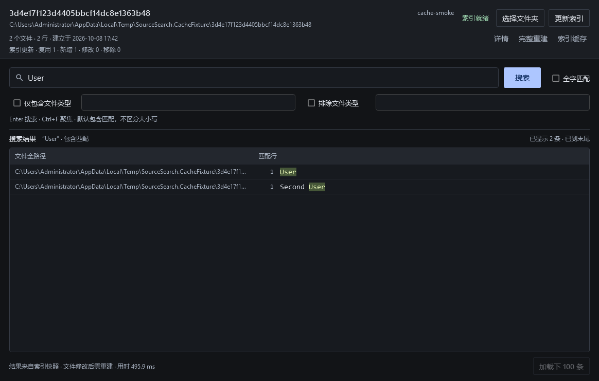
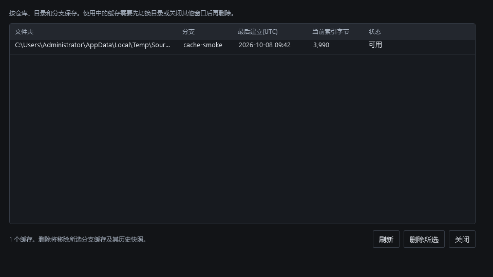

# 第4阶段：缓存与增量更新验证

日期2026-10-08，基线 `e795963`，分支 `codex/index-cache`。用户要求继续推进已约定的Git分支缓存、增量更新和管理器；当前100条批次、命中高亮与已接受UI性能基线保持。

## 已实现

- 缓存键包含仓库路径、选中子目录、分支（游离HEAD为提交SHA）和索引设置；普通文件夹不登记可复用缓存。
- 打开/重返有缓存的Git目录自动检查文件变化，复用或增量更新后搜索；首次无缓存不自动全量建立。同身份文件编辑需点“更新索引”，没有文件监听。
- schema2用稳定文件ID和可删除文件键支持增量；按当前文件集合、每文件时间与长度判断，摘要相同不重新分词，处理新增/修改/删除/重命名/忽略/读失败。旧schema1只读兼容。
- 复制不可变快照后增量修改，完成后原子发布登记；操作锁防并发更新/删除，读取租约保护使用中的快照。失败和取消保留已有登记；身份改变或未知时不发布。
- 实际WPF缓存管理器列出目录、分支、当前快照时间/大小/状态；删除所选有确认，清理该键全部历史快照，使用中拒绝删除。完整重建修复损坏登记或绕过元数据快检。

## 验证

最终检查：Release构建0警告/错误，Core108/108、Presentation25/25，共133项；修复后可见WPF冒烟31/31。RED证据先覆盖增量不读旧文件、增删结果等价、元数据摘要复用（3失败）、缓存接口（5失败）、重启与分支回到旧缓存（2失败），再实现并通过全套。

独立最终审核提出两项重要问题：Git身份读取失败后仍能搜索旧缓存、合法JSON中的空manifest字段会中断整个缓存列表。已先复现失败，再修复身份失效处理和manifest验证，增加4个测试用例。另将删除期间提前释放租约的问题从轻微上调为重要并修复：独占租约保持到删除结束，打开快照先获取读取租约；已有活动缓存删除拒绝、释放后删除的Core与WPF检查通过，但没有通过强制线程交错单独复现该竞态。审核发现项均已处理。

正式桌面项目发布到 `artifacts/stage4-product`，可执行文件存在，发布目录不含Validation组件。最终构建、测试和发布命令分别为 `dotnet build SourceSearch.slnx -c Release --no-restore`、`dotnet test SourceSearch.slnx -c Release --no-build --no-restore`、`dotnet publish src/SourceSearch.Desktop/SourceSearch.Desktop.csproj -c Release --no-restore -o artifacts/stage4-product`；UI验证使用 `scripts/validate-ui-smoke.ps1 -NoBuild`。

测试还覆盖操作锁互斥、取消保留旧登记、使用中不可删除、拒绝目录链接和非法键、损坏登记完整重建、Git忽略新增规则移除旧结果。WPF冒烟实际验证返回Git目录复用、增量增加结果、管理器真实条目、使用中删除拒绝和释放后删除，以及原25项显示与交互命令检查。物理键鼠、原生选择框和物理DPI仍未独立验证；125%/150%为应用内布局缩放。

## 小型夹具测量与旧格式

120个文件、9600行合成Git夹具，单次顺序运行：

| 操作 | 耗时 | 读取源码文件数 |
|---|---:|---:|
| 首次全量建立 | 2150.14ms | 120 |
| 无变化复用 | 360.25ms | 0 |
| 修改1、新增1、删除1 | 484.61ms | 2 |
| 随后完整重建 | 811.16ms | 120 |

增量复用118个文件，三种查询的完整结果与全量重建相同。这里包含Git身份检查、文件枚举和索引操作；顺序运行受JIT/文件缓存影响，不据此推导大仓库加速比例。原始证据见 [cache-probe.json](stage4/cache-probe.json)。

两份已有真实语料schema1快照（C#/混合）在最终manifest验证修复后再次成功只读打开并各返回100条User结果，见 [compat-final.json](stage4/compat-final.json)。没有重新建立或写入真实源码仓库，没有重测全部72组UI性能，也没有变更已接受的基线。

## 限制与取舍

文件修改后若人为保持同长度与时间戳，快检可能漏检；完整重建重新读取全部内容。复制策略保证旧快照可用，代价是增量期间额外磁盘空间和复制耗时；历史快照暂不自动清理。管理器显示当前索引数据大小，不代表该键历史快照总磁盘占用。

旧ui目录索引缺少可靠分支登记，不自动迁移，需首次建立新缓存。存储仍以源码工作区定位，安装路径迁移在发行阶段处理。跨进程锁测试通过同一进程独立缓存服务/独立文件句柄验证锁机制，未执行两个正式应用互点删除的物理操作。

采用本会话既有checkout与PowerShell记录方式，避免重试已失败的辅助工具；代价是没有第二checkout及自动流程记录。自动更新仅针对已有Git缓存，符合等待期间未收到调整时的默认选择。

